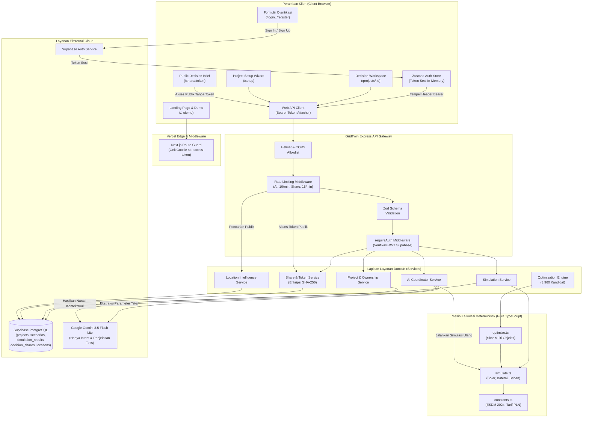

# GridTwin AI

> **Platform Simulasi & Keputusan Transisi Energi Terpadu untuk Pemilik Bangunan Komersial Skala Kecil & Ruko di Indonesia**
> _Dikembangkan untuk INSEVENT 2026 — Kategori Fullstack Web Development (SDG 7: Energi Bersih dan Terjangkau / Integrated Clean Energy Ecosystem)_

[](https://www.typescriptlang.org/)
[](https://nextjs.org/)
[](https://react.dev/)
[](https://expressjs.com/)
[](https://tailwindcss.com/)
[-6E9F18.svg?logo=vitest>)](https://vitest.dev/)
[](https://nodejs.org/)
[](https://pnpm.io/)

---

## Tautan Resmi Proyek & Evaluasi Juri

- **Repositori Sumber Publik:** [https://github.com/herdianftihsan/Gridtwin](https://github.com/herdianftihsan/Gridtwin)
- **Aplikasi Web Produksi (Frontend):** [https://gridtwin-web.vercel.app](https://gridtwin-web.vercel.app) _(Status: Operasional / HTTP 200 OK)_
- **Interactive Sandbox Demo (Tanpa Registrasi):** [https://gridtwin-web.vercel.app/demo](https://gridtwin-web.vercel.app/demo)
- **Endpoint Pemeriksaan Kesehatan Backend (API Health):** [https://gridtwin-api-new.vercel.app/health](https://gridtwin-api-new.vercel.app/health) _(Status: `{"status":"ok"}`)_
  > _Catatan Juri:_ Tautan backend di atas adalah endpoint JSON teknis (`GET /health`) untuk verifikasi kesiapan serverless API, bukan antarmuka pengguna visual. Seluruh interaksi pengguna berpusat pada aplikasi web frontend.

---

## Daftar Isi

1. [Tentang GridTwin AI & Nilai Tambah](#1-tentang-gridtwin-ai--nilai-tambah)
2. [Fitur Utama](#2-fitur-utama)
3. [Akses Demo & Status Deployment](#3-akses-demo--status-deployment)
4. [Tabel Tumpukan Teknologi (Technology Stack)](#4-tabel-tumpukan-teknologi-technology-stack)
5. [Arsitektur Sistem & Alur Kerja](#5-arsitektur-sistem--alur-kerja)
6. [Prasyarat Lingkungan Lokal](#6-prasyarat-lingkungan-lokal)
7. [Panduan Instalasi & Menjalankan Lokal](#7-panduan-instalasi--menjalankan-lokal)
8. [Referensi Variabel Lingkungan (.env)](#8-referensi-variabel-lingkungan-env)
9. [Panduan Inisialisasi Basis Data (Database Setup)](#9-panduan-inisialisasi-basis-data-database-setup)
10. [Ringkasan Rute API Backend](#10-ringkasan-rute-api-backend)
11. [Pengujian Otomatis & Kualitas Kode](#11-pengujian-otomatis--kualitas-kode)
12. [Panduan Pemecahan Masalah (Troubleshooting)](#12-panduan-pemecahan-masalah-troubleshooting)
13. [Batasan Teknis Prototipe](#13-batasan-teknis-prototipe)
14. [Lisensi, Kontribusi & Ucapan Terima Kasih](#14-lisensi-kontribusi--ucapan-terima-kasih)

---

## 1. Tentang GridTwin AI & Nilai Tambah

### Latar Belakang & Permasalahan

Pemilik bangunan komersial skala kecil hingga menengah (_small-to-medium enterprises_ / SME), ruko perkantoran, dan tempat usaha mandiri di Indonesia menghadapi tekanan ganda: lonjakan biaya listrik operasional bulanan dan komitmen adopsi energi bersih (SDG 7). Namun, mereka menghadapi hambatan nyata dalam mengambil keputusan investasi:

1. **Asimetri Informasi & Penawaran Vendor Berat Sebelah:** Proposal vendor energi surya kerap mengusulkan kapasitas panel PV sebesar mungkin tanpa memperhitungkan potensi efisiensi energi (seperti AC inverter, pendingin efisien, atau lampu LED cerdas) yang dapat memangkas konsumsi pada modal yang jauh lebih rendah.
2. **Regulasi Ekspor Listrik Nihil (Permen ESDM No. 2/2024):** Skema _net metering_ kini tidak memberikan kompensasi finansial untuk kelebihan listrik surya yang diekspor ke jaringan PLN. Listrik surya yang melebihi beban siang hari akan terbuang percuma jika tidak dipadukan dengan penyimpanan baterai (_BESS_).
3. **Ketidakpastian Alokasi Anggaran Modal (CAPEX):** Pemilik bangunan kesulitan menghitung kombinasi optimal antara kapasitas PV, kapasitas baterai, dan retrofit efisiensi energi yang paling cepat balik modal (_payback period_) dalam batas anggaran tunai yang dimiliki.

### Solusi GridTwin AI

GridTwin AI hadir sebagai _digital twin workspace_ dan sistem pendukung keputusan independen yang:

- **Mengintegrasikan 6 Aset Transisi Energi:** Memodelkan Solar PV (0–10 kWp), Baterai Penyimpanan (0–20 kWh), AC Inverter (0–5 unit), Retrofit Smart LED, Pendingin Hemat Energi, dan VSD Pompa Air dalam satu kalkulasi terpadu.
- **Memisahkan Kalkulasi Fisika Deterministik dari Generative AI:** Hasil simulasi energi bulanan, tagihan baru, penghematan rupiah, emisi karbon, dan _payback period_ dihitung 100% menggunakan kode matematika deterministik berbasis rumus fisika dan tarif PLN. AI (Google Gemini 3.5 Flash Lite) diposisikan secara ketat sebagai penerjemah bahasa alami (_intent parser_) untuk pertanyaan hipotetis dan pembuat narasi penjelasan kontekstual. AI **tidak pernah** diberi izin mengkalkulasi atau mengubah angka finansial.
- **Optimasi Anggaran Diskrit (3.960 Konfigurasi):** Algoritma optimasi mengevaluasi seluruh ruang kombinasi yang layak terhadap batas anggaran modal (_budget ceiling_) dan luas atap fisik pengguna, lalu memberi rekomendasi berbobot sesuai preferensi (hemat biaya, pangkas CO₂, atau kemandirian energi).
- **Transparansi Estimasi:** Seluruh hasil simulasi adalah estimasi terstruktur berdasarkan asumsi teknik baku (tarif dasar PLN Rp 1.500/kWh, tabel radiasi matahari _Peak Sun Hours_ per kota, efisiensi sistem, dan faktor emisi ESDM 2024), bukan jaminan penghematan finansial mutlak maupun sertifikasi rekayasa teknis kelistrikan formal.

---

## 2. Fitur Utama

| Fitur                                                 | Deskripsi & Nilai Tambah                                                                                                                                                                                         | Status Verifikasi |
| ----------------------------------------------------- | ---------------------------------------------------------------------------------------------------------------------------------------------------------------------------------------------------------------- | ----------------- |
| **Otentikasi & Isolasi Tenant**                       | Registrasi, masuk akun, dan pemulihan kata sandi berbasis Supabase Auth dengan isolasi data tingkat proyek (_tenant isolation_) yang diverifikasi di lapisan middleware API.                                     | Terverifikasi     |
| **Wizard Setup Proyek & Lokasi Indonesia**            | Panduan 4 tahap pengisian profil bangunan (Ruko, Rumah, Kantor), luas atap, tagihan PLN bulanan, batas anggaran modal, serta pencarian otomatis 514 kota/kabupaten se-Indonesia.                                 | Terverifikasi     |
| **Mesin Simulasi Energi Deterministik**               | Pipeline kalkulasi 12 tahap dalam $O(1)$ untuk memodelkan beban harian, pembangkitan surya kota terkait, penyimpanan baterai, sisa impor jaringan, penghematan finansial, dan reduksi CO₂.                       | Terverifikasi     |
| **Optimasi Kombinatorial Diskrit Multi-Objektif**     | Evaluasi 3.960 kandidat sistem dalam $< 50\text{ ms}$ untuk menemukan konfigurasi berkinerja tertinggi yang mematuhi batas anggaran (_CAPEX $\le$ Budget_) dan batasan fisik atap.                               | Terverifikasi     |
| **Visualisasi Energy Twin (Classic & 2.5D)**          | Antarmuka grafis digital twin interaktif dengan dua mode: diagram alir partikel SVG 2D real-time (_Classic_) dan pemodelan isometrik atap/HVAC gedung (_2.5D Isometric Scene_).                                  | Terverifikasi     |
| **What-If Exploration & Narasi AI**                   | Fitur tanya-jawab bahasa alami (misal: _"Bagaimana jika kapasitas solar ditambah ke 6 kWp dan pasang 1 AC?"_). Gemini mengekstrak intensi menjadi parameter uji, lalu mesin deterministik menghitung selisihnya. | Terverifikasi     |
| **Histori & Komparasi Skenario**                      | Penyimpanan riwayat simulasi dengan modal komparasi matriks berdampingan (_side-by-side_) untuk membandingkan skenario Baseline, Rekomendasi, dan Kustom.                                                        | Terverifikasi     |
| **Peta Jalan Investasi (Roadmap)**                    | Panduan transisi 4 fase bertahap (Baseline $\rightarrow$ Efisiensi $\rightarrow$ Solar PV $\rightarrow$ Integrasi Baterai) untuk memudahkan eksekusi investasi sesuai likuiditas pemilik.                        | Terverifikasi     |
| **Ringkasan Keputusan & Berbagi Aman (Public Share)** | Pembuatan tautan publik instan dengan token 256-bit ber-hash SHA-256 dan masa kedaluwarsa 30 hari. Pemilik dapat mencabut tautan kapan saja tanpa membocorkan data privat akun.                                  | Terverifikasi     |
| **Interactive Sandbox Demo**                          | Ruang uji coba publik instan pada rute `/demo` yang langsung berfungsi penuh tanpa perlu registrasi akun atau konfigurasi database lokal.                                                                        | Terverifikasi     |

---

## 3. Akses Demo & Status Deployment

Untuk memberikan kemudahan evaluasi bagi dewan juri, GridTwin AI menyediakan lingkungan demo interaktif yang dapat diakses secara publik tanpa proses masuk akun:

- **Tautan Demo Interaktif:** [https://gridtwin-web.vercel.app/demo](https://gridtwin-web.vercel.app/demo)
- **Karakteristik Lingkungan Demo:**
  - **Bypass Otentikasi Penuh:** Rute `/demo` dikecualikan secara eksplisit dari pemeriksaan rute terproteksi pada Edge Middleware Next.js (`apps/web/src/middleware.ts`). Juri dapat langsung menguji tanpa akun.
  - **Data Acuan Ruko Komersial Nyata:** Memuat proyek percontohan Ruko 2 lantai di Bekasi (Luas Atap 50 m², Tagihan Listrik Rp 4.500.000/bulan, Anggaran Investasi Rp 50.000.000).
  - **Interaktivitas Penuh:** Juri dapat menggeser _slider_ kapasitas panel surya, unit baterai, dan perangkat efisiensi energi, beralih antara visualisasi Classic SVG dan 2.5D Isometric, membuka kalkulasi finansial, hingga melihat ringkasan keputusan investasi.
- **Pengecekan Kesehatan Cloud (Status Deployment Terverifikasi):**
  - Frontend Vercel: Terverifikasi aktif (`HTTP/2 200 OK`).
  - Backend API Serverless: Terverifikasi aktif (`GET https://gridtwin-api-new.vercel.app/health` menghasilkan `HTTP/2 200 OK` dengan payload `{"status":"ok"}`).

---

## 4. Tabel Tumpukan Teknologi (Technology Stack)

| Lapisan (Layer)        | Teknologi Terpilih       | Versi Terverifikasi                        | Peran & Tanggung Jawab dalam GridTwin AI                                                                          |
| ---------------------- | ------------------------ | ------------------------------------------ | ----------------------------------------------------------------------------------------------------------------- |
| **Frontend Framework** | Next.js                  | `15.5.24`                                  | Framework React modern dengan App Router (`(auth)`, `(app)`, `share`), routing dinamis, dan optimasi aset statis. |
| **UI Library**         | React & React DOM        | `19.1.0`                                   | Library render antarmuka deklaratif berbasis komponen dan hooks modern.                                           |
| **Styling**            | Tailwind CSS             | `4.1.0`                                    | Utilitas styling CSS generasi terbaru yang dikompilasi menggunakan `@tailwindcss/postcss`.                        |
| **Animasi & Motion**   | Motion                   | `13.1.1`                                   | Animasi mikro interaktif, partikel aliran daya SVG, transisi stepper modal, dan perpindahan mode visual.          |
| **State Management**   | Zustand                  | `5.0.15`                                   | Manajemen state sesi otentikasi reaktif di sisi peramban (`auth.store.ts`).                                       |
| **Backend Framework**  | Express                  | `4.21.2`                                   | Server REST API modular, pipeline middleware keamanan, penanganan rute, dan controller error terpusat.            |
| **Bahasa & Runtime**   | TypeScript & Node.js     | TS `5.8.3` / `5.7.3`, Node `24.x` (`>=20`) | Pengetikan statis ketat di seluruh monorepo dengan kontrak tipe data terbagi (_shared contracts_).                |
| **Eksekusi Skrip**     | tsx                      | `4.19.2`                                   | Eksekusi file TypeScript instan untuk server pengembangan API dan skrip seeding basis data.                       |
| **Basis Data & Auth**  | Supabase (PostgreSQL)    | `@supabase/supabase-js` `2.112.3`          | Database relasional PostgreSQL cloud, Row Level Security (RLS), dan penyedia otentikasi JWT.                      |
| **AI Provider**        | Google Gemini API        | `@google/genai` `2.22.0`                   | Integrasi model `gemini-3.5-flash-lite` untuk ekstraksi parameter bahasa alami (_intent_) dan narasi keputusan.   |
| **Keamanan HTTP**      | Helmet & CORS            | `helmet` `8.0.0`, `cors` `2.8.5`           | Proteksi header keamanan standar OWASP, pencegahan MIME-sniffing, dan pembatasan origin cross-site.               |
| **Rate Limiting**      | express-rate-limit       | `7.5.0`                                    | Pembatasan frekuensi request IP (10 req/menit untuk AI, 15 req/menit untuk share, 60 req/menit untuk publik).     |
| **Validasi Skema**     | Zod                      | `3.24.2`                                   | Validasi runtime ketat untuk payload request body, query parameter, route params, dan variabel lingkungan.        |
| **Pengujian Otomatis** | Vitest & Testing Library | `vitest` `3.2.4`, RTL `16.3.3`             | Eksekusi 206 pengujian otomatis (unit invariant, benchmark, integrasi API, dan interaksi komponen React).         |
| **Manajer Paket**      | pnpm                     | `10.34.7`                                  | Manajemen dependensi monorepo terisolasi menggunakan workspace protocol (`workspace:*`).                          |
| **Platform Cloud**     | Vercel                   | Edge & Serverless                          | Platform hosting frontend Next.js dan deployment serverless REST API Express.                                     |

---

## 5. Arsitektur Sistem & Alur Kerja

### Struktur Paket Monorepo

Proyek ini dikelola menggunakan struktur pnpm monorepo:

- `apps/web`: Aplikasi frontend Next.js 15 (App Router, visualisasi antarmuka, API client fetcher).
- `apps/api`: REST API backend Express.js (middleware keamanan, kalkulasi simulasi & optimasi, orkestrator AI, repository data).
- `packages/shared`: Definisi tipe data bersama, kontrak error (`API_ERROR_CODES`), skema snapshot brief, dan konstanta domain.
- `supabase`: Berisi file migrasi SQL terstruktur (`migrations/`) dan skrip setup referensi skema inti (`setup/`).

### Diagram Arsitektur Sistem (Mermaid)



---

## 6. Prasyarat Lingkungan Lokal

Sebelum memasang dan menjalankan GridTwin AI secara lokal, pastikan perangkat pengembang memenuhi spesifikasi berikut:

1. **Node.js Runtime:** Versi `24.x` (sesuai konfigurasi target `package.json`) atau versi LTS minimum `>= 20.0.0`.
2. **Manajer Paket pnpm:** Versi `10.34.7` (dikunci melalui konfigurasi `packageManager` monorepo).
3. **Akun Supabase Cloud (PostgreSQL & Auth):** Dibutuhkan instans database Supabase aktif untuk pengujian autentikasi, penyimpanan skenario, dan master lokasi.
4. **Google Gemini API Key (Opsional):** Diperlukan jika ingin menguji fitur eksplorasi bahasa alami _What-If_ dan narasi penjelasan AI. Jika kunci tidak disertakan, sistem tetap berjalan normal dan melakukan simulasi deterministik secara utuh dengan fallback penanganan pesan AI yang ramah pengguna.

---

## 7. Panduan Instalasi & Menjalankan Lokal

Ikuti langkah-langkah berurutan di bawah ini untuk memasang dan menjalankan aplikasi dari repositori bersih:

### Langkah 1: Kloning Repositori Git

```bash
git clone https://github.com/herdianftihsan/Gridtwin.git
cd Gridtwin
```

### Langkah 2: Aktifkan Versi pnpm yang Sesuai

Gunakan `corepack` bawaan Node.js untuk memastikan pnpm versi `10.34.7` aktif:

```bash
corepack enable
corepack prepare pnpm@10.34.7 --activate
```

_Atau pasang secara global:_ `npm install -g pnpm@10.34.7`

### Langkah 3: Pasang Dependensi Workspace Monorepo

```bash
pnpm install
```

### Langkah 4: Siapkan File Variabel Lingkungan (.env)

Salin contoh variabel lingkungan untuk API dan Web:

```bash
# Untuk backend API:
cp apps/api/.env.example apps/api/.env

# Untuk frontend Web:
cp apps/web/.env.example apps/web/.env
```

Buka file `apps/api/.env` dan `apps/web/.env`, lalu isi kredensial Supabase Anda sesuai panduan di [Bagian 8](#8-referensi-variabel-lingkungan-env).

### Langkah 5: Inisialisasi Skema Basis Data

Karena tabel inti domain (`projects`, `scenarios`, `simulation_results`) dikelola langsung pada instans Supabase, jalankan skrip SQL setup terpadu yang telah disediakan di repositori:

1. Buka dashboard proyek Supabase Anda $\rightarrow$ masuk ke menu **SQL Editor**.
2. Buka dan salin seluruh isi file [`supabase/setup/00_core_tables.sql`](file:///home/herdianimmanuel/Documents/Gridtwin/supabase/setup/00_core_tables.sql), lalu klik **Run**.
3. Buka dan jalankan file migrasi master lokasi [`supabase/migrations/20260915000000_create_locations_table.sql`](file:///home/herdianimmanuel/Documents/Gridtwin/supabase/migrations/20260915000000_create_locations_table.sql).
4. Buka dan jalankan file migrasi tautan berbagi [`supabase/migrations/20261015000000_create_decision_shares_table.sql`](file:///home/herdianimmanuel/Documents/Gridtwin/supabase/migrations/20261015000000_create_decision_shares_table.sql).

_(Rincian panduan skema dapat dibaca pada [Bagian 9](#9-panduan-inisialisasi-basis-data-database-setup))._

### Langkah 6: Jalankan Seeding Data Master Lokasi Indonesia

Isi master 514 kota dan kabupaten di Indonesia ke dalam tabel `public.locations`:

```bash
pnpm --filter @gridtwin/api exec tsx src/scripts/seed-locations.ts
```

### Langkah 7: Jalankan Server Pengembangan (2 Terminal)

**Terminal 1 — Backend Express API (Port 4000):**

```bash
pnpm dev:api
```

_Tunggu hingga terminal menampilkan log server siap pada port 4000._

**Terminal 2 — Frontend Next.js Web (Port 3000):**

```bash
pnpm dev:web
```

_Tunggu hingga Next.js siap pada `http://localhost:3000`._

### Langkah 8: Verifikasi Operasional Lokal

1. **Verifikasi Backend:** Buka peramban atau jalankan terminal:
   ```bash
   curl http://localhost:4000/health
   # Respons yang diharapkan: {"status":"ok"}
   ```
2. **Verifikasi Frontend:** Buka peramban ke [http://localhost:3000](http://localhost:3000).
3. **Uji Langsung Mode Demo (Tanpa Login):** Akses [http://localhost:3000/demo](http://localhost:3000/demo).

---

## 8. Referensi Variabel Lingkungan (.env)

> **PERINGATAN KEAMANAN:** Nilai rahasia (_secret credentials_) seperti `SUPABASE_SERVICE_ROLE_KEY` dan `GEMINI_API_KEY` **hanya boleh berada di backend API** dan tidak boleh dikomit ke git atau dikirimkan ke peramban. Variabel frontend yang menggunakan prefiks `NEXT_PUBLIC_` adalah nilai publik yang dikirim ke klien.

### 1. Backend API (`apps/api/.env`)

File ini dibaca secara eksklusif oleh server Express API:

| Variabel                    | Wajib?    | Lingkup (Scope) | Nilai Default Sumber                                    | Contoh Nilai                       | Penjelasan Fungsi                                                                                           |
| --------------------------- | --------- | --------------- | ------------------------------------------------------- | ---------------------------------- | ----------------------------------------------------------------------------------------------------------- |
| `PORT`                      | Opsional  | Server Saja     | `8080` (fallback) / `.env.example`: `4000`              | `4000`                             | Port listening HTTP server API.                                                                             |
| `NODE_ENV`                  | Opsional  | Server Saja     | `development`                                           | `development`                      | Mode eksekusi (`development`, `test`, `production`). Pada mode `test`, mock service key otomatis digunakan. |
| `FRONTEND_URL`              | **Wajib** | Server Saja     | `http://localhost:3000,https://gridtwin-web.vercel.app` | `http://localhost:3000`            | Daftar origin yang diizinkan untuk CORS (dipisahkan tanda koma).                                            |
| `SUPABASE_URL`              | **Wajib** | Server Saja     | _Tidak ada_                                             | `https://your-project.supabase.co` | Alamat endpoint API proyek Supabase Anda.                                                                   |
| `SUPABASE_SERVICE_ROLE_KEY` | **Wajib** | Server Saja     | _Tidak ada_                                             | `eyJh...`                          | Kunci otentikasi istimewa _service-role_ Supabase untuk operasi database server.                            |
| `GEMINI_API_KEY`            | Opsional  | Server Saja     | _Tidak ada_                                             | `AIzaSy...`                        | Kunci API Google AI Studio untuk pemrosesan teks Gemini 3.5 Flash Lite.                                     |
| `GEMINI_MODEL`              | Opsional  | Server Saja     | `gemini-3.5-flash-lite`                                 | `gemini-3.5-flash-lite`            | Identifikasi model Google Gemini yang digunakan.                                                            |
| `GEMINI_TIMEOUT_MS`         | Opsional  | Server Saja     | `15000`                                                 | `15000`                            | Batas waktu request AI dalam milidetik (rentang valid: 1.000–60.000).                                       |
| `GEMINI_MAX_INPUT_CHARS`    | Opsional  | Server Saja     | `2000`                                                  | `2000`                             | Batas maksimum karakter prompt AI (input user query sendiri dibatasi ketat 500 karakter).                   |
| `GEMINI_MAX_OUTPUT_TOKENS`  | Opsional  | Server Saja     | `500`                                                   | `500`                              | Batas token jawaban keluaran AI (rentang valid: 50–4.000).                                                  |

### 2. Frontend Web (`apps/web/.env`)

File ini dibaca oleh aplikasi Next.js (hanya berisi variabel aman untuk browser):

| Variabel                        | Wajib?    | Lingkup (Scope) | Nilai Default Sumber          | Contoh Nilai                       | Penjelasan Fungsi                                                      |
| ------------------------------- | --------- | --------------- | ----------------------------- | ---------------------------------- | ---------------------------------------------------------------------- |
| `NEXT_PUBLIC_API_URL`           | **Wajib** | Browser Publik  | `http://localhost:4000` (dev) | `http://localhost:4000`            | Base URL tujuan panggilan REST API backend.                            |
| `NEXT_PUBLIC_SUPABASE_URL`      | **Wajib** | Browser Publik  | _Tidak ada_                   | `https://your-project.supabase.co` | Endpoint publik Supabase untuk otentikasi login/registrasi di browser. |
| `NEXT_PUBLIC_SUPABASE_ANON_KEY` | **Wajib** | Browser Publik  | _Tidak ada_                   | `eyJh...`                          | Kunci publik _anon key_ Supabase (aman dipublikasikan di browser).     |
| `NEXT_PUBLIC_SITE_URL`          | Opsional  | Browser Publik  | `http://localhost:3000`       | `http://localhost:3000`            | Asal URL kanonikal untuk pengalihan callback otentikasi.               |

---

## 9. Panduan Inisialisasi Basis Data (Database Setup)

### Laporan Transparansi Reproduksibilitas

Dalam repositori Git, terdapat dua kategori skema basis data:

1. **Tabel dengan File Migrasi Terlacak (`supabase/migrations/`):**
   - `20260915000000_create_locations_table.sql`: Membuat tabel `public.locations`.
   - `20261015000000_create_decision_shares_table.sql`: Membuat tabel `public.decision_shares`.
2. **Tabel Inti Domain yang Dibuat Langsung pada Remote Instance:**
   - Tabel `public.projects`, `public.scenarios`, dan `public.simulation_results` pada awalnya diinisialisasi langsung pada instans Supabase produksi.
   - **Solusi Mandiri untuk Juri & Pengembang Baru:** Agar evaluasi lokal dapat direproduksi secara utuh tanpa hambatan pada database baru, repositori ini telah dilengkapi skrip setup terpadu di [`supabase/setup/00_core_tables.sql`](file:///home/herdianimmanuel/Documents/Gridtwin/supabase/setup/00_core_tables.sql) yang direkonstruksi dan divalidasi langsung dari repository TypeScript dan model data aktif.

### Urutan Eksekusi Skema Basis Data Bersih

Buka menu **SQL Editor** pada Supabase Dashboard, lalu jalankan skrip dengan urutan berikut:

```
Urutan Inisialisasi SQL:
[1] supabase/setup/00_core_tables.sql                       -> Membuat projects, scenarios, simulation_results
[2] supabase/migrations/20260915000000_create_locations_table.sql     -> Membuat master locations
[3] supabase/migrations/20261015000000_create_decision_shares_table.sql -> Membuat decision_shares
[4] pnpm --filter @gridtwin/api exec tsx src/scripts/seed-locations.ts -> Seeding 514 kota/kabupaten
```

### Cara Memverifikasi Ketersediaan Tabel

Setelah langkah di atas selesai, jalankan kueri berikut di SQL Editor untuk memastikan 5 tabel utama telah terbentuk:

```sql
SELECT table_name
FROM information_schema.tables
WHERE table_schema = 'public'
  AND table_name IN ('projects', 'scenarios', 'simulation_results', 'locations', 'decision_shares');
```

_Hasil yang diharapkan: Menampilkan 5 baris nama tabel tersebut._

---

## 10. Ringkasan Rute API Backend

GridTwin API diorganisasikan secara modular dengan proteksi otentikasi Bearer JWT, validasi skema Zod, dan pembatasan laju (_rate limiting_):

| Metode   | Endpoint Rute                       | Syarat Otentikasi | Tanggung Jawab & Fungsi Utama                                                                                                               |
| -------- | ----------------------------------- | ----------------- | ------------------------------------------------------------------------------------------------------------------------------------------- |
| `GET`    | `/health`                           | **Publik**        | Pemeriksaan kesehatan instan serverless API (menghasilkan `{"status":"ok"}`).                                                               |
| `GET`    | `/api/health`                       | **Publik**        | Pemeriksaan kesiapan subsistem runtime API.                                                                                                 |
| `GET`    | `/api/locations/search`             | **Publik**        | Pencarian autocomplete nama kota/kabupaten Indonesia dengan perankingan skor kecocokan string ternormalisasi.                               |
| `POST`   | `/api/projects`                     | **Authenticated** | Membuat proyek baru dari data wizard 4-tahap dan menginisialisasi skenario awal.                                                            |
| `GET`    | `/api/projects`                     | **Authenticated** | Menampilkan daftar proyek terpaginasi milik pengguna yang sedang terautentikasi (_tenant isolated_).                                        |
| `GET`    | `/api/projects/:id`                 | **Authenticated** | Mengambil data lengkap proyek tertentu setelah memastikan kepemilikan pengguna (`assertProjectOwnership`).                                  |
| `PATCH`  | `/api/projects/:id`                 | **Authenticated** | Memperbarui profil bangunan, luas atap, anggaran modal, atau sasaran investasi proyek.                                                      |
| `DELETE` | `/api/projects/:id`                 | **Authenticated** | Menghapus proyek beserta riwayat skenario dan hasil simulasi terkait secara bertingkat (_cascade_).                                         |
| `GET`    | `/api/projects/:id/scenarios`       | **Authenticated** | Mengambil seluruh riwayat skenario yang pernah disimulasikan dan disimpan pada suatu proyek.                                                |
| `GET`    | `/api/projects/:id/roadmap`         | **Authenticated** | Menghasilkan rekomendasi peta jalan investasi bertahap (Baseline $\rightarrow$ Efisiensi $\rightarrow$ Solar $\rightarrow$ Baterai).        |
| `POST`   | `/api/projects/:id/simulate`        | **Authenticated** | Menjalankan kalkulasi simulasi energi deterministik (`persist: false` untuk pratinjau instan, `persist: true` untuk menyimpan).             |
| `POST`   | `/api/projects/:id/optimize`        | **Authenticated** | Menjalankan mesin optimasi kombinatorial multi-objektif (evaluasi 3.960 kandidat konfigurasi terhadap anggaran).                            |
| `POST`   | `/api/projects/:id/shares`          | **Authenticated** | Menghasilkan tautan publik ringkasan keputusan ber-hash kriptografis SHA-256 (dibatasi 15 pembuatan/menit).                                 |
| `GET`    | `/api/projects/:id/shares/active`   | **Authenticated** | Mengambil status tautan publik aktif yang sedang berlaku untuk proyek terkait.                                                              |
| `DELETE` | `/api/projects/:id/shares/:shareId` | **Authenticated** | Mencabut (_revoke_) tautan publik secara seketika sehingga tidak dapat diakses kembali oleh publik.                                         |
| `GET`    | `/api/shares/:token`                | **Publik**        | Mengambil snapshot ringkasan keputusan investasi hanya-baca yang telah disanitasi dari data sensitif (dibatasi 60 req/menit).               |
| `PATCH`  | `/api/scenarios/:id`                | **Authenticated** | Memperbarui nama kustom skenario atau menandai skenario sebagai rekomendasi aktif.                                                          |
| `DELETE` | `/api/scenarios/:id`                | **Authenticated** | Menghapus skenario tertentu beserta hasil perhitungan simulasinya dari basis data.                                                          |
| `POST`   | `/api/ai/what-if`                   | **Authenticated** | Mengekstrak parameter konfigurasi teknis dari teks pertanyaan bahasa alami pengguna menggunakan Gemini (dibatasi 10 req/menit).             |
| `POST`   | `/api/ai/explain`                   | **Authenticated** | Menghasilkan narasi ringkas (trade-off & insight) berbasis hasil numerik simulasi terverifikasi menggunakan Gemini (dibatasi 10 req/menit). |

> _Petunjuk Dokumentasi Tambahan:_ Untuk penelusuran arsitektur mendalam, formula matematika per fase, dan matriks bobot optimasi, silakan rujuk dokumen teknis komprehensif pada [`docs/technical-documentation-research.md`](file:///home/herdianimmanuel/Documents/Gridtwin/docs/technical-documentation-research.md).

---

## 11. Pengujian Otomatis & Kualitas Kode

Keandalan GridTwin AI divalidasi melalui rangkaian uji otomatis komprehensif yang mencakup pengujian invarian matematika murni, pengujian batas keamanan API, hingga pengujian interaksi komponen visual.

### Ringkasan Eksekusi Pengujian (Status: 100% Lolos)

```
========================================================================================
Matriks Hasil Uji Mutu GridTwin AI (Terverifikasi Penuh)
========================================================================================
Perintah Uji         | Cakupan Evaluasi       | Berkas Uji    | Total Tes   | Status
---------------------+------------------------+---------------+-------------+-----------
pnpm typecheck       | Seluruh Monorepo       | 3 Workspace   | TypeScript  | PASSED (0 Error)
pnpm lint            | Analisis Statis ESLint | Seluruh File  | Ruleset     | PASSED (0 Error)
pnpm test:api        | apps/api & shared      | 16 Berkas     | 137 Tes     | PASSED (100%)
pnpm test:web        | apps/web               | 18 Berkas     | 89 Tes      | PASSED (100%)
---------------------+------------------------+---------------+-------------+-----------
Total Monorepo Unik  | Hasil Bersih Terdedup  | 31 Berkas Uji | 206 Tes     | 100% LOLOS
pnpm build           | Kompilasi Produksi     | Workspace     | 11 Halaman  | PASSED (0 Error)
========================================================================================
```

> **Catatan Rekonsiliasi Jumlah Tes:** Perintah `pnpm test:api` menjalankan 16 berkas uji (137 tes), yang mencakup 3 berkas tes unit logika TypeScript murni pada `apps/web/src/lib/` (20 tes). Saat menjalankan `pnpm test:web`, ke-18 berkas uji frontend dijalankan (89 tes). Menjumlahkan $137 + 89 = 226$ menghitung ke-20 tes unit web tersebut dua kali. Jumlah tes unik tanpa duplikasi di seluruh monorepo adalah **206 tes unik pada 31 berkas uji**.

### Perintah Pemeriksaan Kualitas yang Dapat Dijalankan

Jalankan perintah-perintah berikut dari direktori utama (_root_) repositori:

1. **Pemeriksaan Ketat Tipe Data (Typecheck):**

   ```bash
   pnpm typecheck
   ```

   _Memvalidasi keselarasan tipe data TypeScript tanpa menghasilkan file emisi di seluruh paket._

2. **Pemeriksaan Gaya Kode (Linter):**

   ```bash
   pnpm lint
   ```

   _Memastikan standar kode ESLint ditaati tanpa adanya warning maupun error terdeteksi._

3. **Menjalankan Seluruh Rangkaian Tes Monorepo:**

   ```bash
   pnpm test
   ```

   _Membangun paket shared, lalu menjalankan seluruh pengujian API dan Web._

4. **Menjalankan Tes Spesifik Backend & Shared:**

   ```bash
   pnpm test:api
   ```

   _Menguji invarian fisika simulasi, benchmark kecepatan optimasi, otentikasi, rate limit, dan API share brief._

5. **Menjalankan Tes Spesifik Frontend Web:**

   ```bash
   pnpm test:web
   ```

   _Menguji interaksi wizard setup, validasi mata uang, perpindahan mode 2.5D Energy Twin, dan proteksi rute._

6. **Kompilasi Bundle Produksi (Production Build):**
   ```bash
   pnpm build
   ```
   _Membangun bundle produksi untuk `@gridtwin/shared`, `@gridtwin/api`, dan aplikasi `@gridtwin/web`._

---

## 12. Panduan Pemecahan Masalah (Troubleshooting)

| Gejala Masalah                                                                  | Kemungkinan Penyebab                                                                                             | Langkah Diagnostik & Solusi Aman                                                                                                                                               |
| ------------------------------------------------------------------------------- | ---------------------------------------------------------------------------------------------------------------- | ------------------------------------------------------------------------------------------------------------------------------------------------------------------------------ |
| **Pemasangan pnpm gagal / lockfile error**                                      | Versi pnpm lokal berbeda dari versi yang dipin pada monorepo (`10.34.7`).                                        | Jalankan `corepack enable && corepack prepare pnpm@10.34.7 --activate` untuk menyamakan versi manajer paket resmi.                                                             |
| **Backend crash saat startup: `Invalid environment variables`**                 | Variabel wajib `SUPABASE_URL` atau `SUPABASE_SERVICE_ROLE_KEY` belum terisi pada `apps/api/.env`.                | Buka `apps/api/.env` dan pastikan URL proyek Supabase serta kunci _service-role_ telah terisi sesuai dashboard Supabase.                                                       |
| **Frontend gagal memanggil API (Network Error / CORS)**                         | Nilai `NEXT_PUBLIC_API_URL` tidak sesuai dengan port API atau `FRONTEND_URL` di backend belum mencakup port web. | Pastikan `apps/web/.env` menyetel `NEXT_PUBLIC_API_URL=http://localhost:4000` dan backend menyertakan `http://localhost:3000` pada `FRONTEND_URL`.                             |
| **Gagal membuat proyek: `Could not find the table 'public.projects'`**          | Tabel inti belum diinisialisasi pada instans Supabase yang baru dibuat.                                          | Jalankan skrip setup SQL [`supabase/setup/00_core_tables.sql`](file:///home/herdianimmanuel/Documents/Gridtwin/supabase/setup/00_core_tables.sql) melalui Supabase SQL Editor. |
| **Pencarian kota/kabupaten tidak menampilkan hasil**                            | Tabel `public.locations` belum dibuat atau belum di-seed dengan data master.                                     | Jalankan migrasi `supabase/migrations/20260915000000_create_locations_table.sql` lalu eksekusi `pnpm --filter @gridtwin/api exec tsx src/scripts/seed-locations.ts`.           |
| **Gagal membuat link berbagi: `Could not find table 'public.decision_shares'`** | Tabel migrasi tautan berbagi belum diterapkan pada database Supabase.                                            | Jalankan file migrasi `supabase/migrations/20261015000000_create_decision_shares_table.sql` melalui Supabase SQL Editor.                                                       |
| **Fitur What-If atau Penjelasan AI menampilkan pesan error sementara**          | Kunci `GEMINI_API_KEY` tidak diisi, kuota habis, atau terkena rate limit Google AI Studio.                       | Periksa isi `GEMINI_API_KEY` di `apps/api/.env`. Sistem secara otomatis mengaktifkan fallback aman sehingga angka simulasi tetap muncul normal.                                |
| **Node.js engine warning saat build**                                           | Versi Node.js yang digunakan di bawah v20.                                                                       | Perbarui instalasi Node.js ke versi LTS minimum v20.x atau versi v24.x yang direkomendasikan.                                                                                  |

---

## 13. Batasan Teknis Prototipe

Sebagai prototipe yang dirancang untuk kompetisi rekayasa web, GridTwin AI memiliki sejumlah batasan teknis yang perlu dipahami secara transparan:

1. **Pemodelan Berbasis Asumsi Baku (Bukan Rekayasa Lapangan Detail):**
   - Hasil kalkulasi adalah **estimasi deterministik terstruktur**, bukan jaminan legal penghematan tagihan PLN di masa mendatang.
   - Radiasi matahari harian menggunakan angka _Peak Sun Hours_ (PSH) rata-rata tahunan per ibukota provinsi (rentang 4,0–4,8 jam/hari) dari tabel in-memory, bukan pembacaan sensor cuaca satelit real-time per jam.
   - Pola konsumsi beban listrik menggunakan asumsi pembagian siang/malam 50:50 yang merepresentasikan tipikal operasional ruko/kantor kecil, bukan pencatatan logger profil beban sub-menit.
2. **Kepatuhan Regulasi Ekspor Nol (Permen ESDM No. 2/2024):**
   - Sistem memodelkan kebijakan nasional terkini di mana surplus listrik surya tidak mendapat kompensasi rupiah dari PLN. Kelebihan daya tanpa baterai dihitung sebagai _wasted surplus_.
3. **Konstanta Biaya Investasi Rata-Rata:**
   - Biaya perangkat dihitung menggunakan estimasi pasar nasional wajar (Solar PV Rp 15 jt/kWp, Baterai Rp 5 jt/kWh, AC Inverter Rp 5 jt/unit, LED Rp 1,5 jt/lot, dsb.) dan belum mencakup variasi biaya instalasi struktur atap spesifik atau biaya perizinan setempat.
4. **Reproduksibilitas Skema Database:**
   - Tabel inti domain (`projects`, `scenarios`, `simulation_results`) memerlukan eksekusi file DDL pendukung [`supabase/setup/00_core_tables.sql`](file:///home/herdianimmanuel/Documents/Gridtwin/supabase/setup/00_core_tables.sql) saat disiapkan pada instans Supabase kosong.

---

## 14. Lisensi, Kontribusi & Ucapan Terima Kasih

### Status Lisensi Repositori

Repositori ini dikembangkan sebagai karya kompetisi untuk ajang **INSEVENT 2026 Fullstack Web Development Competition**. Saat ini belum ada lisensi sumber terbuka (_open-source license_) publik formal yang dideklarasikan dalam repositori. Seluruh hak cipta arsitektur dan kode sumber dimiliki oleh tim pengembang GridTwin AI.

### Panduan Pengembangan & Kontribusi

Pengembangan monorepo mengikuti panduan tata kelola repositori ketat yang didefinisikan dalam [`AGENTS.md`](file:///home/herdianimmanuel/Documents/Gridtwin/AGENTS.md):

- **Disiplin Kontrak Tipe:** Kontrak API dan respons envelope bersifat terkunci (_locked contracts_).
- **Invarian Simulasi:** Logika simulasi dan optimasi bersifat deterministik murni; provider AI eksternal dilarang dimasukkan ke dalam rantai perhitungan matematika numerik.
- **Standar Validasi:** Setiap perubahan kode wajib lolos uji `pnpm typecheck`, `pnpm lint`, dan `pnpm test`.

### Sumber Daya & Rujukan Data Terbuka

- Data administratif wilayah kota dan kabupaten di Indonesia bersumber dari rilis terbuka [lokabisa-oss/region-id](https://github.com/lokabisa-oss/region-id) (v1.0.1).
- Faktor emisi jaringan kelistrikan Jawa-Bali ($0,79\text{ kg CO}_2/\text{kWh}$) merujuk pada pedoman inventarisasi gas rumah kaca Kementerian ESDM Republik Indonesia (2024).
